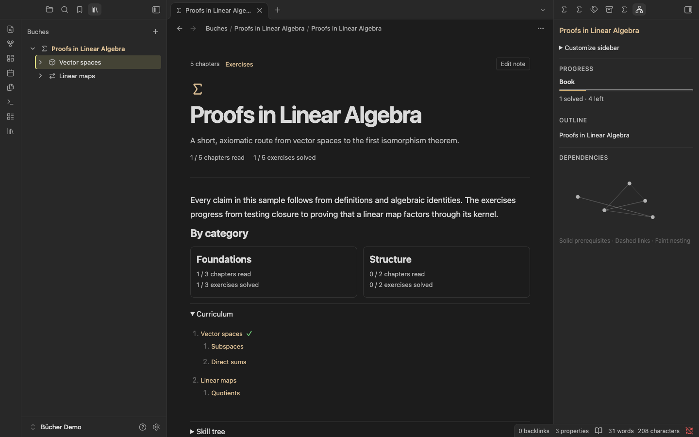
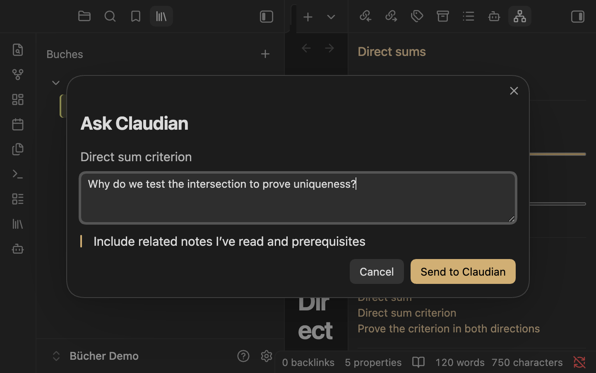
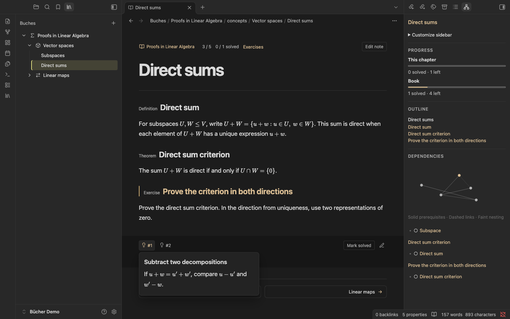
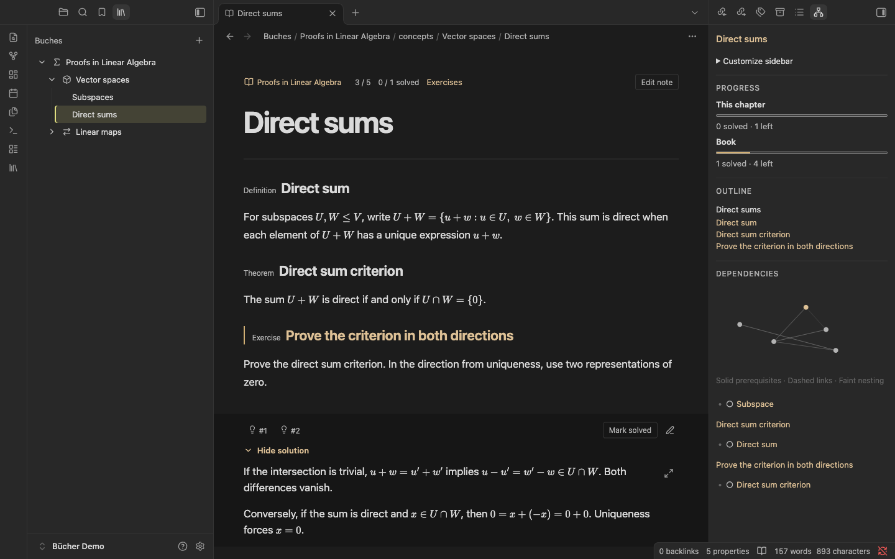
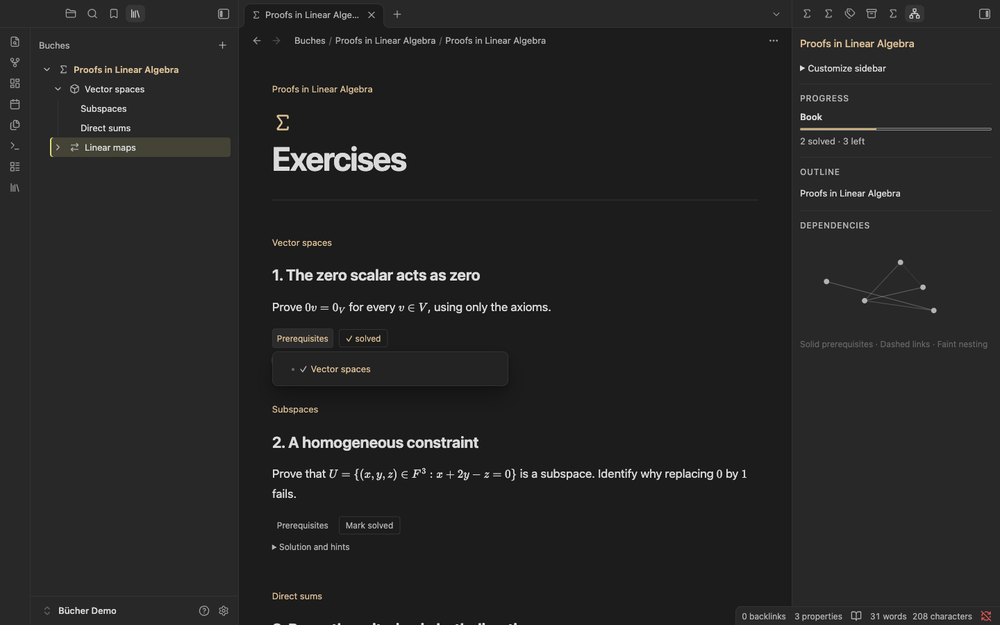

# Bücher for Obsidian

Turn a folder of Markdown notes into a book with ordered chapters, an exercise sheet, and a place to work on proofs.

[](https://github.com/mateusdcc/obsidian-buches/releases/download/0.2.0/buches-demo.mp4)

[Watch the demo](https://github.com/mateusdcc/obsidian-buches/releases/download/0.2.0/buches-demo.mp4) · [See screenshots](#screenshots) · [Create books with an agent](https://github.com/mateusdcc/buches-author)

## Install

1. Download `buches-0.4.1.zip` from the [GitHub release](https://github.com/mateusdcc/obsidian-buches/releases/latest).
2. Extract its `buches` folder into `<vault>/.obsidian/plugins/`. The folder should contain `main.js`, `manifest.json`, and `styles.css`.
3. In Obsidian, enable **Bücher** under **Settings → Community plugins**. Click the library ribbon icon or run **Open Buches**.
4. To try the sample, extract `demo-book.zip` into your vault, or copy the repository’s [demo/Buches](demo/Buches/) folder to the vault root. Keep your existing `Buches` folder if you already have one; copy only the sample book into it.

Tested on Obsidian desktop 1.14.5 and 1.15.0. MathJax is built into Obsidian. To use Typst, install and enable Typst Mate; otherwise choose MathJax for both settings.

## Navigate and create

- The **Create Buch** command prompts for a title and creates `Buches/<TITLE>/_index.md` with `title`, `type`, and `created` properties.
- The **Buches** sidebar shows a collapsible tree of Buch titles and concepts. Click a title to open it in the reader; use the chevron to expand or collapse its children. Hover a row (or use keyboard focus) to reveal its plus button. The plus next to a Buch creates a top-level concept at `Buches/<TITLE>/concepts/<Concept>.md`; the plus next to any concept creates a subconcept.
- Subconcepts can nest to any depth. For example, a child of `concepts/Parent.md` is stored in `concepts/Parent/Child.md`; its children go in `concepts/Parent/Child/`. The original parent note stays in place. Each concept has a `name` frontmatter property.
- Use the library ribbon icon or **Open Buches** command to reopen the sidebar.
- Buches are recognized by an `_index.md` file one level below `Buches/`; each concept is a Markdown file, with optional children in a same-named folder. Keep the note and its child folder named together when renaming or moving them, or the navigator cannot associate them. The display name falls back to the folder or filename when metadata is absent.
- Names with filesystem-reserved characters or path separators are rejected; existing files and folders are never overwritten.

## Reading and editing

Open the book title for reading progress and category totals. Expand **Curriculum** or **Skill tree** when you want more detail. The right sidebar has **Progress**, **Outline**, and **Dependencies**. **Customize sidebar** shows, hides, and reorders them.

**Edit note** opens the whole chapter in Obsidian’s native editor within the same pane. **Back to reading** returns to the reader. Advancing with the next chapter arrow records the current chapter as read. **Finish book** records the last chapter and returns to the index. Exercise completion is recorded separately with **Mark solved**. Progress is stored in the book’s `_progress.md`.

Hover or focus a book or concept in the navigator, then select the clipboard icon on the right to open its exercise sheet. The sheet includes descendants in curriculum order and pulls prompts from their source chapters. The **Prerequisites** popover links to the source concept and any declared or linked learning blocks.

On first reveal, an existing worked proof moves into a regular Markdown note in the book’s `_solutions/` folder and the chapter gains an Obsidian `![[…]]` embed. The pencil opens the native embed editor, and the check closes it. The embedded note saves using Obsidian’s editor. Numbered lamps show hints when requested.

Under **Settings → Buches**, choose **Reader math** and the default **Solution math** for newly created solution notes. An explicit `buches-math` comment chooses the engine when its proof is moved. The generated note stores that choice as a `renderer` property.

## Solution tabs

Open **Reveal solution** and choose **+ Solution** to keep another attempt for the same exercise. **+ AI** appears when Claudian is enabled. Choose **Concise** (the default), **Step by step**, **Proof sketch**, or **First step only**. You can add a method or constraint, such as “Prove $\det(A^T)=\det(A)$ by reindexing the Leibniz formula.” The reply follows the exercise’s language unless you request another.

With Claudian for Bücher, each request runs in the background and the reply is saved directly to its tab. The regular Claudian plugin still supports the chat handoff for generating solutions. AI solutions use MathJax, including existing proofs written with `\(…\)` or `\[…\]`. You can switch between attempts, edit them with the pencil, and review the selected attempt. Each tab is stored as a separate note under the book's `_solutions/` folder. Exercise completion is shared across tabs.

## Grading solutions

The bar-chart button opens the grade for the selected solution. Click **Grade solution** to start a separate request with [Claudian for Bücher](https://github.com/mateusdcc/claudian/releases/latest). The window shows progress and lets you cancel. Expand **Review details** for the model’s summary, with live updates when the provider offers them. The result shows each criterion, its score from 0 to 10, the reason, and comments next to the lines being discussed. Bücher calculates the weighted total. Changing the solution or the rubric prompts for a new grade.

Configure criteria in the book’s `_index.md`:

```yaml
grading:
  - id: correctness
    label: Correctness
    weight: 1
    criteria: Check every inference and whether the proof establishes the stated conclusion.
```

Add as many criteria as needed, with unique IDs and positive weights. The grade is attached to the selected solution note.

## Study with Claudian

Enable [Claudian](https://github.com/yishentu/claudian) in the same vault. Hover or focus a definition, theorem, example, or exercise to find the question button. The chapter toolbar also has a question button for the whole note.

- **Ask Claudian.** The prompt includes the note path, block reference and excerpt. With related reading enabled, Bücher looks up declared prerequisites and up to five relevant excerpts, including chapters marked as read across books. It ranks excerpts by shared words and keeps exercise solutions out of this lookup. Clear the checkbox to send just the selected context.
- **Patch.** The wand opens Claudian Inline edit with the chapter body or the selected callout body. Enter your instruction and inspect the diff before applying it. Block patches keep the callout header and block ID outside the editable range.
- **Review a proof.** The checklist button sends the exercise and the saved solution, including solutions stored in embedded notes. You can paste a different attempt in the dialog. The prompt asks Claudian to explain any gap and give a hint for correcting it.

With an active Claudian session, **Send to Claudian** queues the prompt. For a new chat, the integration prepares a draft for you to send. The chat follows your Claudian provider settings. Tested with Claudian 2.3.38. [Claudian plugin API](https://github.com/yishentu/claudian/blob/main/docs/plugin-api.md)

### Background tutoring and book memory

Install [Claudian for Bücher](https://github.com/mateusdcc/claudian/releases/latest) in the same vault for inline grading and AI solutions. The fork shares the upstream plugin ID and reuses your configured providers. See the fork's release for installation steps.

Bücher uses [MiniSearch](https://github.com/lucaong/minisearch) to search the book index, chapters, and learning blocks locally. The background task receives the exercise, a few relevant passages, declared prerequisites, and which retrieved material you have read. Saved solutions stay outside the memory index. A grading request includes the attempt you select. The [tutor](skills/buches-proof-tutor/SKILL.md) and [reviewer](skills/buches-proof-reviewer/SKILL.md) skills supply the task instructions. Other Obsidian plugins can call `app.plugins.getPlugin('buches').bookTools.search(bookPath, query)` or `.read(bookPath, ref)` for the same book-scoped lookup.

[](docs/media/claudian.png)

## Chapter template for authors and AI

Create `Buches/<Book>/_index.md` with a title, an optional description, and an introduction. The reader generates the rest of the index from the chapters. For each chapter, use this structure:

```markdown
---
name: Direct sums
description: Recognize and prove uniqueness of direct sum decompositions.
category: Foundations
order: 2
depends_on:
  - "[[Buches/Linear Algebra/concepts/Vector Spaces]]"
block_depends_on:
  unique-decomposition:
    - "[[#^direct-sum]]"
  direct-sum-proof:
    - "[[#^unique-decomposition]]"
---

# Direct Sums

> [!definition] Direct sum
> The sum $U+W$ is direct when each vector has a unique decomposition $u+w$.

^direct-sum

> [!theorem] Uniqueness of decomposition
> If $U\cap W=\{0\}$, then $U+W$ is a direct sum.

^unique-decomposition

> [!exercise] Prove the direct sum criterion
> Let $U$ and $W$ be subspaces with $U\cap W=\{0\}$. Prove that each decomposition is unique.

^direct-sum-proof

> [!hint]- First step
> Subtract two decompositions of the same vector.

> [!hint]- Identify the subspace
> Show that the difference of the two $U$ components lies in $W$.

---
<!-- buches-math: mathjax -->
If $u_1+w_1=u_2+w_2$, then $u_1-u_2=w_2-w_1$ belongs to $U\cap W$.
It is zero, so both components agree.
---
```

Use `definition`, `theorem`, `lemma`, `proposition`, `corollary`, `example`, and `exercise` callouts for indexed learning blocks. Add a unique anchor on its own line after each callout. Use `block_depends_on` to attach prerequisites to a block anchor and `depends_on` for chapter prerequisites. A prerequisite can point to a chapter or to `[[Chapter#^block-id]]`. Use full vault paths when filenames overlap.

Keep numbered hints in consecutive `[!hint]` callouts after the exercise prompt. Use two standalone `---` lines for the solution. Use `***` for a horizontal rule. Legacy `### Exercise: …` headings are recognized, and adding a solution engine comment such as `<!-- buches-math: mathjax -->` keeps a LaTeX proof on MathJax when the default for solutions is Typst.

## Development

The maintainable source is split across `src/` (storage, catalog, modal, view, and plugin lifecycle). Obsidian loads one compiled `main.js`; it is generated from those modules and should not be edited by hand.

```sh
npm ci
npm test
npm run build
```

Copy the three installable files into a test vault’s `.obsidian/plugins/buches/` and reload the plugin after building. The example vault content is synthetic and separate from the plugin.

## Screenshots

| Numbered hint | Worked proof | Exercise sheet |
| --- | --- | --- |
| [](docs/media/hint.png) | [](docs/media/proof.png) | [](docs/media/exercise-sheet.png) |
